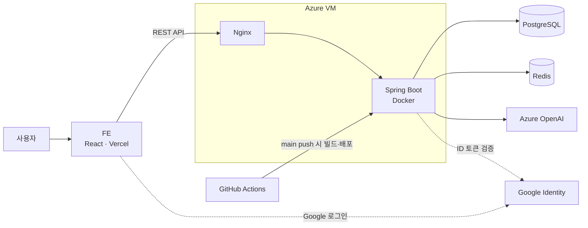

# 🏠 복작복작 BE

> 생활습관의 언어를 통일하고, 서로의 조율 가능성으로 매칭해 입주 전 오해와 갈등을 줄이는 대학생 룸메이트 매칭 서비스의 백엔드입니다.


멋쟁이사자처럼 4호선톤 · Team 16 본가가고싶다

- 서비스: https://bok-jak-bok-jak-fe.vercel.app
- API 문서(Swagger): 백엔드 주소의 `/swagger-ui.html`
- FE 레포: https://github.com/bokjakbokjak-project/BokJakBokJak_FE

## 목차

1. [기획 배경](#기획-배경)
2. [전체 흐름](#전체-흐름)
3. [체험하기](#체험하기)
4. [주요 기능](#주요-기능)
5. [기술 스택](#기술-스택)
6. [시스템 구조](#시스템-구조)
7. [패키지 구조](#패키지-구조)
8. [ERD](#erd)
9. [API 명세](#api-명세)
10. [매칭 알고리즘](#매칭-알고리즘)
11. [설계 포인트](#설계-포인트)
12. [로컬 실행](#로컬-실행)
13. [배포](#배포)
14. [팀](#팀)

## 기획 배경

기숙사 룸메이트 갈등은 대부분 취침 시간, 알람, 청소, 흡연, 냉난방 같은 생활습관 차이에서 생깁니다. 복작복작은 같은 학교·성별·기숙사 학생 중에서 **내 습관과 상대가 허용하는 범위**가 잘 맞는 사람을 추천하고, 대화 단계에서 서로 다른 습관을 규칙으로 미리 정할 수 있게 돕습니다.

| | Pain Point | Solution |
| --- | --- | --- |
| 룸메이트 찾기 | 생활습관을 모른 채 룸메이트를 정함 | 상황형 설문으로 "내 습관"과 "허용 범위"를 함께 비교해 매칭률 순으로 추천 |
| 첫 대화 | 습관 차이를 먼저 꺼내기 어려움 | 습관이 다른 주제를 AI가 대화 안건으로 만들어 하나씩 정하게 함 |
| 함께 살기 | 살아 보고 나서야 갈등이 드러남 | 최종 매칭 전에 규칙을 미리 정하고, 두 사람이 모두 확정해야 매칭 완료 |

## 전체 흐름

```
[1] 알아보기
 │    학교 계정 로그인  →  우선순위 · 상황형 설문  →  매칭률 순 추천 · AI 분석
 │
 ▼
[2] 대화하기
 │    대화 신청 · 채팅방 생성  →  AI가 만든 생활 규칙 안건  →  안건 하나씩 확정
 │
 ▼
[3] 함께 살기
      두 사람 모두 확정  →  최종 매칭 완료  →  다른 대화는 자동 종료
```

## 체험하기

학교 구글 계정이 없어도 이름만으로 체험할 수 있습니다.

1. 서비스 접속 후 **체험하기**에서 이름 입력
2. 생활습관 우선순위(3~6개)와 상황형 설문 16문항 응답
3. 홈에서 추천 룸메이트와 매칭률 확인
4. 후보의 AI 매칭 분석과 상세 프로필 확인
5. 대화 신청 후 채팅방에서 AI가 만든 생활 규칙 안건 확인

시크릿 창에서 다른 이름으로 한 번 더 체험하면 두 계정끼리 대화, 안건 확정, 최종 매칭까지 확인할 수 있습니다. 체험 계정은 테스트용 가상 사용자(페르소나)와 같은 후보군(동국대 남산학사 2인실)으로 만들어집니다.

## 주요 기능

| 기능 | 설명 |
| --- | --- |
| 학교 계정 로그인 | Google 학교 계정(`hd`)으로 학교를 확인하고, 같은 학교끼리만 매칭 |
| 온보딩 | 학과, 학번, 성별, 기숙사·방 타입, 생활습관 우선순위 |
| 상황형 설문 | 6개 카테고리, 8개 주제. 주제마다 "내 습관"과 "룸메이트에게 허용하는 범위"를 묻는 16문항 |
| 룸메이트 추천 | 같은 학교·성별·기숙사·방 타입 후보를 매칭률 순으로 추천 |
| AI 매칭 분석 · 생활습관 요약 | 두 사람의 설문을 바탕으로 잘 맞는 점, 조율할 점을 AI가 정리 |
| 대화와 안건 조율 | 대화 신청 즉시 채팅방 생성, 습관이 다른 주제를 AI가 안건으로 만들어 하나씩 확정 |
| 최종 매칭 | 두 사람이 모두 확정하면 매칭 완료, 다른 대화는 자동 종료 |
| 알림 | 대화 신청, 상대 확정, 최종 매칭, 대화 중지, 상대의 다른 매칭, 안건 초기화 |
| 공유하기 | 내 설문 결과를 링크로 공유하고, 받은 사람은 학교와 상관없이 매칭률 확인 |
| 재설문 | 설문 문항이 바뀌면 기존 회원을 다시 설문하게 하고 예전 답을 미리 채워 줌 |

### 매칭 상태

```
 대화 신청
     │
     ▼
┌──────────┐
│ CHATTING │
└────┬─────┘
     ├──────────▶ CONFIRMED    두 사람 모두 확정
     │
     └──────────▶ ENDED        한 사람이 중지 · 상대가 다른 사람과 최종 매칭
```

### 안건 상태

```
 WAITING ──이전 안건 확정──▶ DISCUSSING ──확정──▶ DECIDED
```

채팅방이 열리면 AI가 습관이 다른 주제로 안건 2개를 만들고, 첫 안건부터 하나씩 논의합니다. 한쪽이 다시 설문하면 안건을 지우고 새 설문 기준으로 다시 만듭니다.

## 기술 스택

| 구분 | 사용 기술 |
| --- | --- |
| 언어·프레임워크 | Java 21, Spring Boot 4.1 (Web MVC, Security, Data JPA, Validation) |
| 데이터 | PostgreSQL, Flyway, Redis(리프레시 토큰, 추천 캐시) |
| 인증 | Google ID 토큰 검증, 자체 JWT(액세스 30분, 리프레시 14일) |
| AI | Azure OpenAI (설정이 없으면 설문 기반 기본 문구로 동작) |
| 문서 | springdoc-openapi (Swagger UI) |
| 테스트 | JUnit 5, Spring Boot Test, H2 |
| 배포 | Docker, GitHub Actions(PR 테스트, main push 시 자동 배포), Nginx, Azure VM |

## 시스템 구조



## 패키지 구조

```
kr.bokjakbokjak
├── auth            구글·체험·테스트 로그인, JWT 발급과 재발급
├── user            회원, 온보딩, 프로필, 내 상태
├── university      학교와 학교 이메일 도메인
├── dormitory       기숙사·방 타입 검색과 등록
├── survey          설문 문항, 설문 제출, 설문 프로필
├── matching        모듈 간 인터페이스와 매칭 엔진(engine)
├── recommendation  추천 리스트, AI 매칭 분석, 생활습관 요약
├── room            대화 신청, 채팅, 안건 조율, 최종 매칭
├── notification    알림
├── share           공유 링크 매칭률
├── ai              Azure OpenAI 연동
└── common          보안 설정, 공통 응답·예외
```

## ERD

테이블 16개, 5개 영역으로 구성됩니다. 회원·설문·학교·기숙사 테이블은 **Flyway 마이그레이션**으로, 추천·채팅·알림 테이블은 **JPA 엔티티**로 관리합니다.

| 영역 | 테이블 | 관리 |
| --- | --- | --- |
| 회원 | `app_user` `user_weight`(카테고리 우선순위) | Flyway |
| 설문 | `survey_category` `survey_topic` `question` `question_option` `survey_answer` | Flyway |
| 학교 · 기숙사 | `university` `university_domain` `dormitory_room_type` | Flyway |
| 추천 · AI | `ai_analysis`(두 사람의 AI 분석) `lifestyle_summary`(개인 요약) | JPA |
| 대화 · 매칭 | `matching` `agenda` `chat_message` `notification` | JPA |

**설계 시 고려한 지점**

- **같은 두 사람의 매칭은 한 줄** — `matching`은 두 사용자 ID를 작은 값·큰 값 순서로 저장하고 UNIQUE를 걸었습니다. A→B, B→A 신청이 동시에 와도 방이 두 개 생기지 않습니다.
- **설문 차수로 최신 여부 판단** — `ai_analysis`, `lifestyle_summary`, `matching`에 계산 당시 설문 차수를 저장합니다. 차수가 같으면 저장본을 그대로 쓰고, 다르면 다시 만듭니다.
- **안건 순서 고정** — `agenda`는 (매칭, 순서)에 UNIQUE를 걸어 같은 방에 안건이 중복으로 만들어지지 않게 했습니다.
- **탈퇴해도 행은 유지** — 회원은 지우지 않고 상태(`ACTIVE`, `WITHDRAWN`, `SUSPENDED`)만 바꿔 대화 기록이 깨지지 않게 했습니다.

## API 명세

전체 명세는 Swagger에서 볼 수 있습니다. 응답 필드명은 snake_case이고, 모든 응답은 공통 형식으로 감싸집니다.

```json
{
  "success": true,
  "code": "COMMON2000",
  "message": "요청에 성공했습니다.",
  "data": { }
}
```

실패하면 `data` 대신 `errors`가 오고, `code`에 `SURVEY_REQUIRED` 같은 에러 코드가 들어갑니다.

<details>
<summary>엔드포인트 전체 보기</summary>

**인증**

| Method | Endpoint | 설명 |
| --- | --- | --- |
| POST | `/api/auth/login` | 구글 학교 계정 로그인 |
| POST | `/api/auth/guest-login` | 체험 로그인 |
| POST | `/api/auth/refresh` | 토큰 재발급 |
| POST | `/api/auth/logout` | 로그아웃 |
| POST | `/api/auth/dev-login` | 테스트 로그인 (개발·시연용) |
| POST | `/api/auth/dev-reset` | 테스트 계정 초기화 (개발·시연용) |

**회원 · 온보딩 · 기숙사**

| Method | Endpoint | 설명 |
| --- | --- | --- |
| GET | `/api/me/status` | 내 상태와 다음 화면 |
| PUT | `/api/me/onboarding` | 온보딩 저장 |
| GET | `/api/me/profile` | 내 성향 프로필 |
| PATCH | `/api/me/profile` | 닉네임 변경 |
| GET | `/api/dormitories?keyword=` | 기숙사·방 타입 검색 |
| POST | `/api/dormitories` | 기숙사·방 타입 등록 |

**설문**

| Method | Endpoint | 설명 |
| --- | --- | --- |
| GET | `/api/surveys/current` | 현재 설문 문항 |
| GET | `/api/me/survey` | 내 설문 응답 |
| PUT | `/api/me/survey` | 설문 제출·수정 |

**추천 · AI**

| Method | Endpoint | 설명 |
| --- | --- | --- |
| GET | `/api/recommendations` | 추천 리스트 |
| POST | `/api/recommendations/refresh` | 추천 새로고침 |
| GET | `/api/recommendations/{target_user_id}/analysis` | AI 매칭 분석 |
| GET | `/api/roommates/{candidate_id}/profile` | 후보 상세 프로필 |
| GET | `/api/users/{user_id}/lifestyle-summary` | 생활습관 AI 요약 |

**대화 · 매칭**

| Method | Endpoint | 설명 |
| --- | --- | --- |
| POST | `/api/matchings` | 대화 신청 |
| GET | `/api/matchings/me` | 채팅방 목록 |
| GET | `/api/matchings/{matching_id}` | 채팅방 정보 (상대, 안건, 확정 여부) |
| GET | `/api/matchings/{matching_id}/messages?after_id=` | 새 메시지 (폴링) |
| GET | `/api/matchings/{matching_id}/messages?before_id=` | 이전 메시지 |
| POST | `/api/matchings/{matching_id}/messages` | 메시지 보내기 |
| PATCH | `/api/matchings/{matching_id}/agendas/{agenda_id}/decide` | 안건 확정 |
| PATCH | `/api/matchings/{matching_id}/confirm` | 최종 매칭 확정 |
| PATCH | `/api/matchings/{matching_id}/end` | 매칭 중지 |

**알림 · 공유**

| Method | Endpoint | 설명 |
| --- | --- | --- |
| GET | `/api/notifications` | 알림 목록 |
| PATCH | `/api/notifications/{notification_id}/read` | 알림 읽음 처리 |
| GET | `/api/notifications/unread-count` | 안 읽은 알림 개수 |
| GET | `/api/share/{user_id}/match-score` | 공유 링크 매칭률 |

</details>

## 매칭 알고리즘

1. **주제별 판정**: 상대의 실제 습관이 내 허용범위 안이면 1점. 벗어나면 선택지를 실제 값(취침 시각, 알람 횟수, 청소 간격, 치우기까지 걸리는 시간)으로 바꿔 벗어난 정도만큼 깎습니다. 예: 24시에 자는 사람 ↔ 23시까지 허용하는 사람 → 1시간 늦음 → 0.67점
2. **가중치**: 모든 카테고리 기본 10점에 내가 고른 우선순위 보너스(1순위 +12 … 6순위 +0.25)를 더합니다.
3. **방향별 점수**: 내 기준으로 본 상대 점수와 상대 기준으로 본 내 점수를 각각 가중 평균합니다.
4. **최종 매칭률**: 두 방향의 조화평균. 한쪽만 만족하는 조합은 낮게 나옵니다. 흡연자를 받을 수 없는 사람과 흡연자가 만나면 0.6을 곱합니다.

"잘 모르겠다", 조건부 허용("큰 소음이 아니라면 상관없다")은 점수와 별도로 **확인 필요** 라벨을 붙여 대화 안건으로 이어집니다. 주제별 계산식은 [개발 문서의 매칭 점수 계산](docs/DEVELOPMENT.md#매칭-점수-계산)에 있습니다.

## 설계 포인트

### AI가 실패해도 서비스는 멈추지 않도록

AI 매칭 분석, 생활습관 요약, 대화 안건은 모두 AI가 만들지만, AI가 없어도 동작합니다.

```
LlmClient
├── AzureOpenAiLlmClient   설정이 있을 때. 타임아웃·오류면 빈 결과
└── StubLlmClient          설정이 없을 때. 항상 빈 결과
```

- AI 응답은 JSON 형식, 글자 수, 주제 누락 등을 검증하고, 통과하지 못하면 한 번 더 요청합니다.
- 두 번 모두 실패하면 설문 답변으로 만든 **기본 문구**(`DefaultMatchSentences`, `DefaultAgendas`)로 대신합니다.
- 기본 문구는 저장하지 않아서, 다음 조회 때 AI로 다시 시도합니다.
- 점수와 안건 주제 선택은 매칭 엔진이 정하고, AI는 **문장만** 씁니다. AI가 없는 주제를 만들거나 판정을 바꿀 수 없습니다.

### 설문 차수로 캐시를 관리

사용자가 설문을 낼 때마다 `survey_revision`이 1씩 오릅니다. AI 분석, 생활습관 요약, Redis 추천 캐시, 채팅방 안건이 모두 이 차수로 "아직 최신인지"를 판단합니다.

- 차수가 같으면 저장본을 재사용해 AI 호출과 재계산을 줄입니다.
- 설문 문항이 바뀌어 재설문을 받을 때도 차수를 0으로 되돌리지 않습니다. 되돌리면 다시 1이 됐을 때 옛 분석이 최신처럼 재사용되기 때문입니다. 완료 여부는 `survey_completed_at`으로 따로 봅니다.
- 추천 리스트는 Redis에 저장한 결과에서 차수가 바뀐 후보만 다시 계산합니다. 새로고침은 전체를 다시 계산하고, 순위가 바뀌었는지(`changed`)를 알려줍니다.

### 동시에 눌러도 결과가 하나가 되도록

| 상황 | 처리 |
| --- | --- |
| 두 사람이 같은 안건을 동시에 확정 | `DISCUSSING`일 때만 바꾸는 조건부 UPDATE. 한 명만 성공하고 확정 메시지도 하나만 남음 |
| 두 사람이 동시에 최종 확정 | `matching`에 낙관적 락(`@Version`), 충돌하면 최대 3번 재시도 |
| 한 사람이 두 방에서 동시에 최종 확정 | 한 방만 확정되고 다른 방은 자동 종료 |
| A↔B가 서로 동시에 대화 신청 | 두 사람 ID 쌍에 UNIQUE. 방은 하나만 생성 |

모두 여러 스레드로 동시에 요청하는 테스트로 확인했습니다.

### 오래 걸리는 작업은 응답 뒤에

대화 신청 응답은 바로 돌려주고, AI 안건 생성은 **트랜잭션 커밋 후 비동기**로 처리합니다(`@TransactionalEventListener(AFTER_COMMIT)` + `@Async`). 재설문 시 채팅방 초기화도 같은 방식입니다. 커밋 후에 실행하므로 롤백된 매칭으로 안건을 만드는 일이 없습니다. 재설문 초기화를 놓쳐도 채팅방을 열거나 최종 확정할 때 차수를 비교해 다시 맞춥니다.

### 모듈 사이는 인터페이스로

백엔드 두 명이 회원·설문 쪽과 추천·채팅 쪽을 나눠 동시에 개발했습니다. 두 쪽은 `matching` 패키지의 인터페이스(`UserQueryService`, `MatchingEngine`, `SurveyProfileQueryService`)로만 연결됩니다. 실제 구현이 나오기 전에는 샘플 구현(`MatchingFixture`)으로 먼저 개발하고, 구현이 끝난 뒤 코드 수정 없이 바꿔 끼웠습니다.

### 운영 DB를 지키는 마이그레이션

- 스키마는 Flyway로만 바꾸고, 이미 적용된 파일은 고치지 않습니다.
- JPA가 만든 테이블은 enum 컬럼에 허용 값 CHECK 제약이 붙고, `ddl-auto: update`는 이 제약을 갱신하지 않습니다. 새 알림 종류가 운영에서만 저장되지 않는 문제를 배포 전에 찾아 마이그레이션(V10)으로 제약을 정리했습니다.

## 로컬 실행

**요구사항**: JDK 21, PostgreSQL, Redis

```bash
# 1. 환경 변수 설정
cp .env.example .env
# .env에서 DB_URL, DB_USERNAME, DB_PASSWORD, REDIS_URL을 로컬 환경에 맞게 수정
set -a; source .env; set +a
export JWT_SECRET_BASE64="$(openssl rand -base64 32)"

# 2. 테스트 (H2 메모리 DB 사용, PostgreSQL·Redis 불필요)
./gradlew test

# 3. 실행
./gradlew bootRun
```

| | URL |
| --- | --- |
| 헬스 체크 | http://localhost:8080/api/health |
| Swagger UI | http://localhost:8080/swagger-ui.html |

Azure OpenAI 설정이 없어도 기본 문구로 동작합니다. 환경 변수 전체 설명과 API 세부 규칙, 테스트 페르소나는 [docs/DEVELOPMENT.md](docs/DEVELOPMENT.md)에 있습니다.

## 배포

`main` 브랜치에 머지되면 자동으로 배포됩니다.

```
dev → main 머지
   │
   ├─ Gradle bootJar 빌드
   ├─ Docker 이미지 빌드 → GHCR 푸시
   ├─ Azure VM SSH 접속 → 컨테이너 교체
   ├─ /api/health 확인
   └─ 디스코드 알림
```

`dev`·`main`으로 올라온 PR은 GitHub Actions에서 **PR 코드 단독 테스트**와 **최신 dev와 합친 결과 테스트**를 모두 실행합니다. 인프라 구성과 배포 방법은 [docs/DEPLOY.md](docs/DEPLOY.md)에 있습니다.

## 팀

| BackEnd | BackEnd | FrontEnd | Product Manager · FrontEnd | Designer | Designer |
| :---: | :---: | :---: | :---: | :---: | :---: |
| **신채희** | **이세호** | **손현우** | **임수연** | **정아인** | **조민서** |
| 룸메이트 추천 · AI 매칭 분석 · AI 안건 조율 채팅 · 최종 매칭 · 알림 | 로그인 · 온보딩 · 설문 · 매칭 점수 엔진 · 마이페이지 · 체험 로그인 · 공유 | 초기 세팅 · 로그인/체험하기 · 온보딩 · 홈/알림 · 추천/분석 화면 · 마이페이지 · 온보딩/설문/프로필 API 연동 | 상황형 설문 · 설문 결과/프로필 카드 · 채팅/조율 화면 · 추천/채팅 API 연동 · 카카오 공유 · 사용자 테스트 버전 · UI QA | 기획 · UI/UX 디자인 | 기획 · UI/UX 디자인 |
