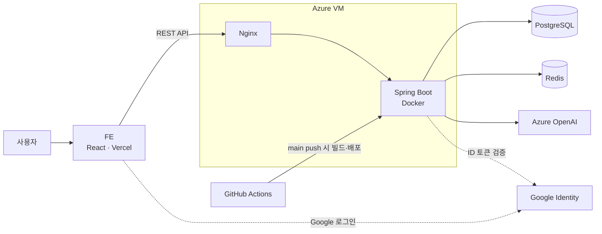

# 복작복작 BE

> 상황형 설문으로 생활습관을 비교해 기숙사 룸메이트를 추천하고, AI가 함께 지낼 규칙 정하기를 돕는 서비스의 백엔드입니다.

- 서비스: https://bok-jak-bok-jak-fe.vercel.app
- API 문서(Swagger): 백엔드 주소의 `/swagger-ui.html`
- FE 레포: https://github.com/bokjakbokjak-project/BokJakBokJak_FE

## 왜 만들었나요

기숙사 룸메이트 갈등은 대부분 취침 시간, 알람, 청소, 흡연, 냉난방 같은 생활습관 차이에서 생깁니다. 복작복작은 같은 학교·성별·기숙사 학생 중에서 **내 습관과 상대가 허용하는 범위**가 잘 맞는 사람을 추천하고, 대화 단계에서 서로 다른 습관을 규칙으로 미리 정할 수 있게 돕습니다.

## 체험하기

학교 구글 계정이 없어도 이름만으로 체험할 수 있습니다.

1. 서비스 접속 후 **체험하기**에서 이름 입력
2. 생활습관 우선순위(3~6개)와 상황형 설문 16문항 응답
3. 홈에서 추천 룸메이트와 매칭률 확인
4. 후보의 AI 매칭 분석과 상세 프로필 확인
5. 대화 신청 후 채팅방에서 AI가 만든 생활 규칙 안건 확인

시크릿 창에서 다른 이름으로 한 번 더 체험하면 두 계정끼리 대화, 안건 확정, 최종 매칭까지 확인할 수 있습니다. 체험 계정은 테스트용 가상 사용자(페르소나)와 같은 후보군(동국대 남산학사 2인실)으로 만들어집니다.

## 주요 기능

| 기능 | 설명 |
| --- | --- |
| 학교 계정 로그인 | Google 학교 계정(`hd`)으로 학교를 확인하고, 같은 학교끼리만 매칭 |
| 온보딩 | 학과, 학번, 성별, 기숙사·방 타입, 생활습관 우선순위 |
| 상황형 설문 | 6개 카테고리, 8개 주제. 주제마다 "내 습관"과 "룸메이트에게 허용하는 범위"를 묻는 16문항 |
| 룸메이트 추천 | 같은 학교·성별·기숙사·방 타입 후보를 매칭률 순으로 추천 |
| AI 매칭 분석 · 생활습관 요약 | 두 사람의 설문을 바탕으로 잘 맞는 점, 조율할 점을 AI가 정리 |
| 대화와 안건 조율 | 대화 신청 즉시 채팅방 생성, 습관이 다른 주제를 AI가 안건으로 만들어 하나씩 확정 |
| 최종 매칭 | 두 사람이 모두 확정하면 매칭 완료, 다른 대화는 자동 종료 |
| 알림 | 대화 신청, 상대 확정, 최종 매칭, 대화 중지 등 |
| 공유하기 | 내 설문 결과를 링크로 공유하고, 받은 사람은 학교와 상관없이 매칭률 확인 |
| 재설문 | 설문 문항이 바뀌면 기존 회원을 다시 설문하게 하고 예전 답을 미리 채워 줌 |

## 기술 스택

| 구분 | 사용 기술 |
| --- | --- |
| 언어·프레임워크 | Java 21, Spring Boot 4.1 (Web MVC, Security, Data JPA, Validation) |
| 데이터 | PostgreSQL, Flyway, Redis(리프레시 토큰, 추천 캐시) |
| 인증 | Google ID 토큰 검증, 자체 JWT(액세스 30분, 리프레시 14일) |
| AI | Azure OpenAI (설정이 없으면 설문 기반 기본 문구로 동작) |
| 문서 | springdoc-openapi (Swagger UI) |
| 테스트 | JUnit 5, Spring Boot Test, H2 |
| 배포 | Docker, GitHub Actions(PR 테스트, main push 시 자동 배포), Nginx, Azure VM |

## 시스템 구조



## 매칭 알고리즘

1. **주제별 판정**: 상대의 실제 습관이 내 허용범위 안이면 1점. 벗어나면 선택지를 실제 값(취침 시각, 알람 횟수, 청소 간격, 치우기까지 걸리는 시간)으로 바꿔 벗어난 정도만큼 깎습니다. 예: 24시에 자는 사람 ↔ 23시까지 허용하는 사람 → 1시간 늦음 → 0.67점
2. **가중치**: 모든 카테고리 기본 10점에 내가 고른 우선순위 보너스(1순위 +12 … 6순위 +0.25)를 더합니다.
3. **방향별 점수**: 내 기준으로 본 상대 점수와 상대 기준으로 본 내 점수를 각각 가중 평균합니다.
4. **최종 매칭률**: 두 방향의 조화평균. 한쪽만 만족하는 조합은 낮게 나옵니다. 흡연자를 받을 수 없는 사람과 흡연자가 만나면 0.6을 곱합니다.

"잘 모르겠다", 조건부 허용("큰 소음이 아니라면 상관없다")은 점수와 별도로 **확인 필요** 라벨을 붙여 대화 안건으로 이어집니다. 자세한 계산은 아래 [매칭 점수 계산](#매칭-점수-계산)에 있습니다.

## 주요 API

전체 명세는 Swagger에서 볼 수 있습니다. 응답은 `success, code, message, data` 형식이고 필드명은 snake_case입니다.

| 영역 | API |
| --- | --- |
| 인증 | `POST /api/auth/login` 구글 로그인 · `POST /api/auth/guest-login` 체험 로그인 · `POST /api/auth/refresh` · `POST /api/auth/logout` |
| 회원 | `GET /api/me/status` 다음 화면 · `PUT /api/me/onboarding` · `GET`·`PATCH /api/me/profile` |
| 기숙사 | `GET /api/dormitories?keyword=` · `POST /api/dormitories` |
| 설문 | `GET /api/surveys/current` · `GET`·`PUT /api/me/survey` |
| 추천 | `GET /api/recommendations` · `POST /api/recommendations/refresh` · `GET /api/recommendations/{target_user_id}/analysis` · `GET /api/roommates/{candidate_id}/profile` · `GET /api/users/{user_id}/lifestyle-summary` |
| 대화·매칭 | `POST /api/matchings` 대화 신청 · `GET /api/matchings/me` · `GET`·`POST /api/matchings/{matching_id}/messages` · `PATCH /api/matchings/{matching_id}/agendas/{agenda_id}/decide` · `PATCH /api/matchings/{matching_id}/confirm` · `PATCH /api/matchings/{matching_id}/end` |
| 알림 | `GET /api/notifications` · `PATCH /api/notifications/{notification_id}/read` · `GET /api/notifications/unread-count` |
| 공유 | `GET /api/share/{user_id}/match-score` |

## 패키지 구조

```
kr.bokjakbokjak
├── auth            구글·체험·테스트 로그인, JWT 발급과 재발급
├── user            회원, 온보딩, 프로필, 내 상태
├── university      학교와 학교 이메일 도메인
├── dormitory       기숙사·방 타입 검색과 등록
├── survey          설문 문항, 설문 제출, 설문 프로필
├── matching        모듈 간 인터페이스와 매칭 엔진(engine)
├── recommendation  추천 리스트, AI 매칭 분석, 생활습관 요약
├── room            대화 신청, 채팅, 안건 조율, 최종 매칭
├── notification    알림
├── share           공유 링크 매칭률
├── ai              Azure OpenAI 연동
└── common          보안 설정, 공통 응답·예외
```

## 개발 방식

- 이슈 → 브랜치(`feat/{이슈번호}-설명`) → PR → `dev` 머지 → `main` 머지 시 자동 배포
- `dev`·`main`으로 올라온 PR마다 GitHub Actions에서 테스트를 실행합니다.
- DB 스키마는 Flyway 마이그레이션으로만 바꾸고, 적용된 파일은 수정하지 않습니다.

---

# 개발 문서

## 로컬 실행

Java 21과 저장소의 Gradle Wrapper를 사용합니다. 초기 설정은 Spring Boot 4.1.1과 Gradle 9.7.1입니다. 로컬 앱 실행에는 PostgreSQL 데이터베이스와 Redis 서버가 필요합니다. 테스트는 별도의 메모리 DB(H2)를 사용합니다.

```bash
cp .env.example .env
# .env에서 DB_URL, DB_USERNAME, DB_PASSWORD, REDIS_URL을 로컬 환경에 맞게 수정
set -a
source .env
set +a
export JWT_SECRET_BASE64="$(openssl rand -base64 32)"
./gradlew test
./gradlew bootRun
```

다른 터미널에서 `curl -i http://localhost:8080/api/health`로 확인합니다. Windows에서는 `gradlew.bat`를 사용합니다.

- `DB_URL`은 PostgreSQL JDBC 주소이며 기본값은 `jdbc:postgresql://localhost:5432/bokjakbokjak`입니다. 해당 데이터베이스를 먼저 생성해야 합니다.
- `DB_USERNAME`의 기본값은 `bokjakbokjak`이고, `DB_PASSWORD`는 사용하는 PostgreSQL 계정의 비밀번호입니다.
- `REDIS_URL`의 기본값은 `redis://localhost:6379`입니다. 인증이 필요하면 비밀번호가 포함된 연결 URL을 설정합니다.
- `JWT_SECRET_BASE64`에는 Base64로 인코딩한 32바이트 이상의 비밀 키를 넣습니다.
- `CORS_ALLOWED_ORIGINS`는 허용할 FE 주소를 쉼표로 구분합니다. 로컬 기본값은 `http://localhost:5173`입니다.
- `SERVER_PORT`의 기본값은 `8080`, `JWT_ACCESS_TTL`의 기본값은 `30m`입니다.
- `JWT_ISSUER`와 `JWT_AUDIENCE`의 기본값은 각각 `bokjakbokjak`, `bokjakbokjak-api`입니다.
- `GOOGLE_CLIENT_ID`는 Google 로그인에 쓰는 OAuth 웹 클라이언트 ID입니다. ID 토큰의 대상(`aud`)이 이 값과 같아야 로그인됩니다. 비어 있으면 Google 로그인은 모두 실패합니다.
- `JWT_REFRESH_TTL`은 리프레시 토큰 유효 기간이며 기본값은 `14d`입니다. 리프레시 토큰은 Redis에 저장합니다.
- `DEV_LOGIN_KEY`는 테스트 로그인·초기화 키입니다. 비어 있으면 두 API가 꺼집니다(404).
- `GUEST_LOGIN_ENABLED`는 체험 로그인을 켤지 정합니다. 기본값은 `true`입니다.
- `MATCHING_CANDIDATE_SCOPE`는 추천 후보 범위입니다. 기본값 `ROOM_TYPE`은 같은 기숙사·같은 방 타입만, `DORMITORY`는 같은 기숙사면 방 타입이 달라도 후보로 봅니다.
- `AZURE_OPENAI_ENDPOINT`, `AZURE_OPENAI_API_KEY`, `AZURE_OPENAI_DEPLOYMENT`, `AZURE_OPENAI_API_VERSION`은 AI 요약·분석·안건 생성에 쓰는 Azure OpenAI 설정입니다. 하나라도 비어 있으면 AI를 호출하지 않고 설문 답변 기반의 기본 문구로 동작하므로, 로컬 실행과 테스트에는 없어도 됩니다.
- `.env.example`은 변수 이름과 예시값만 담습니다. 실제 비밀번호와 JWT 키가 들어간 `.env`는 Git에서 제외됩니다.
- 앱이 뜰 때 Flyway가 `src/main/resources/db/migration`의 SQL을 먼저 적용하고, 그다음 JPA `ddl-auto: update`가 마이그레이션에 없는 테이블을 만듭니다.
  - 회원·설문·온보딩·기숙사 테이블은 Flyway로 관리합니다. 스키마를 바꿀 때는 기존 파일을 고치지 말고 `V{다음번호}__설명.sql`을 새로 추가합니다.
  - 추천·채팅·조율 테이블은 엔티티 기준으로 `update`가 만듭니다. 같은 테이블을 Flyway와 엔티티 양쪽에서 만들지 않습니다.
- 일반 `jar`는 비활성화하고 실행용 `bootJar`만 만듭니다.

## 공통 HTTP 계약

성공 응답은 `success, code, message, data`, 실패 응답은 `success, code, message, errors`를 사용합니다. 기본 성공 코드는 `COMMON2000`입니다. `ErrorCode`가 공통 오류 코드·메시지·HTTP 상태를 관리하고, `ApiExceptionHandler`가 예외를 같은 형식으로 반환합니다. HTTP 응답 필드명은 snake_case입니다. 보호된 경로는 서비스가 발급한 `Authorization: Bearer <access_token>`을 받습니다.

JPA 엔티티가 생성·수정 시각이 필요하면 `BaseEntity`를 상속합니다. `created_at`과 `updated_at`은 JPA Auditing으로 기록됩니다.

`GET /api/health`를 실행할 수 있습니다. 설문 문항은 `GET /api/surveys/current`, 내 설문 응답은 `GET`·`PUT /api/me/survey`로 조회·저장합니다(로그인 필요). 우선순위는 온보딩 때 저장되므로 설문 전에도 `GET /api/me/survey`의 `priorities`에 들어 있습니다. 설문 차수가 올라가면 `SurveyRevisionChangedEvent(userId, revision)`를 발행합니다.

## 로그인과 토큰

- `POST /api/auth/login`: FE가 Google Identity Services에서 받은 ID 토큰(`id_token`)을 보내면 서명·발급자·대상(`GOOGLE_CLIENT_ID`)·만료를 검증하고 서비스 토큰을 발급합니다. 처음 로그인하면 회원을 만듭니다.
  - 학교 Google Workspace 계정만 받습니다. ID 토큰의 `hd`가 있어야 하고, `hd`나 이메일 도메인 중 하나가 `university_domain`에 등록된 학교여야 합니다. 학교 추가는 SQL로 도메인만 넣으면 됩니다.
  - 응답의 `next_step`은 온보딩 전 `ONBOARDING`, 설문 전 `SURVEY`, 둘 다 마치면 `HOME`입니다.
- `GET /api/me/status`는 로그인한 사용자의 현재 상태를 돌려줍니다. FE는 앱 시작이나 첫 화면 진입 때 호출해 이동할 화면을 정합니다.
  - `onboarding_completed`, `survey_completed`, `next_step`(로그인 응답과 같은 기준), `matched`, `matching_id`(최종 매칭 전이면 null)
  - `survey_update_required`는 예전에 설문을 냈지만 문항이 바뀌어 다시 해야 하는 경우 true입니다. 이때 `next_step`은 `SURVEY`입니다.
- 액세스 토큰은 30분, 리프레시 토큰은 14일입니다. `POST /api/auth/refresh`로 두 토큰을 모두 새로 받고, 쓴 리프레시 토큰은 바로 폐기됩니다.
- `POST /api/auth/logout`은 현재 액세스 토큰을 남은 시간 동안 차단하고 리프레시 토큰을 지웁니다.
- `POST /api/auth/dev-login`은 개발·시연용입니다. `X-Dev-Login-Key` 헤더가 `DEV_LOGIN_KEY`와 같고 대상이 테스트 유저일 때만 토큰을 줍니다.
  - 본문은 `{"user_id": 1002}`처럼 회원 ID로 보냅니다. `nickname`으로도 찾을 수 있지만 닉네임은 중복을 허용하므로 같은 이름의 테스트 계정이 여러 명이면 400입니다.
  - CORS에서 `X-Dev-Login-Key` 헤더를 허용하므로 브라우저에서도 호출할 수 있습니다.
- `POST /api/auth/guest-login`은 심사·데모용 체험 로그인입니다. 구글 계정 없이 `{"nickname": "홍길동"}`만 보내면 매번 새 체험 계정을 만들고 토큰을 줍니다.
  - 체험 계정은 동국대 남산학사 2인실·여성·온보딩 완료 상태의 테스트 계정입니다. 테스트 페르소나와 같은 후보군이라 설문을 마치면 페르소나와 다른 체험자를 추천받습니다.
  - 닉네임은 일반 회원과 같은 규칙이고 중복을 허용합니다. 응답의 `next_step`은 `SURVEY`이고, 우선순위는 설문 제출 때 함께 보냅니다.
  - `GUEST_LOGIN_ENABLED=false`로 끌 수 있습니다(기본 켜짐). 꺼져 있으면 404입니다.
- `POST /api/auth/dev-reset`은 시연 리허설용 초기화입니다. 같은 키로 보호되며, 두 사람 모두 테스트 유저인 매칭과 그 매칭의 메시지·안건·알림을 지웁니다. 실제 회원이 포함된 매칭은 남깁니다.
- 테스트에서는 Redis 대신 메모리 저장소(`InMemoryAuthTokenStore`)를 씁니다.

## 온보딩과 기숙사

- `PUT /api/me/onboarding`은 학과·학번·이름(닉네임)·성별·출생년도·방 타입·카테고리 순위를 한 번에 저장합니다. 회원 정보와 순위는 한 트랜잭션으로 바뀝니다.
  - 방 타입은 본인 학교 것이어야 하고, MVP에서는 2인실만 고를 수 있습니다.
  - 카테고리 순위 규칙은 설문 제출과 같습니다(`CategoryPriorityValidator`).
  - 첫 설문 제출 전에는 다시 저장할 수 있고, 제출 후에는 409입니다. 저장하면 `next_step`이 `SURVEY`가 됩니다.
- `GET /api/dormitories?keyword=`는 본인 학교 기숙사를 이름으로 검색해 기숙사별로 방 타입을 묶어 돌려줍니다. 2인실만, 이름순 최대 30개입니다.
- `POST /api/dormitories`는 검색에 없는 기숙사·방 타입을 등록합니다. 이름의 공백을 빼고 비교해서 같은 태그면 기존 `room_type_id`를 돌려줍니다.

## 설문 개편과 재설문 (V11)

- 식기 문항을 빼고 온도(냉난방) 카테고리와 문항 2개를 추가했습니다. 문항은 16개 그대로이고 카테고리는 6개입니다. 흡연이 13·14번, 온도가 15·16번입니다.
- 설문을 마친 실제 회원은 `survey_completed_at`을 비워 다시 설문하게 합니다. 설문 차수는 그대로 둡니다. 0으로 돌리면 다시 제출했을 때 옛 차수의 AI 분석·요약 캐시가 최신으로 재사용되기 때문입니다.
- 설문 완료는 `survey_completed_at` 기준(`User.isSurveyCompleted`), 설문을 낸 적이 있는지는 차수 기준(`User.hasSubmittedSurvey`)입니다. 후보 조회는 설문을 완료한 회원만 대상으로 합니다.
- 다시 설문하는 사용자는 `GET /api/me/survey`에서 예전 답과 현재 차수를 받고, 제출할 때 `expected_revision`에 현재 차수를 보냅니다.
- 테스트 페르소나는 온도 답을 넣고 차수를 1 올려 캐시를 새로 만들게 했습니다.

## 프로필

- `GET /api/me/profile`은 마이페이지 「상세 답변 요약」입니다. 카테고리 6개를 표시 순서대로, 그 안의 주제를 표시 순서대로 담습니다. 순위 선택과 관계없이 8개 주제가 모두 들어갑니다.
  - 주제마다 습관 질문 문구(`question`), 나의 성향(`habit_answer`), 원하는 성향(`tolerance_answer`)을 선택지 원문으로 줍니다. 설문 전이면 409입니다.
  - 나이(`age`)는 한국식(올해 − 출생년도 + 1)이며 추천 카드와 같은 `KoreanAge`를 씁니다.
- `GET /api/roommates/{candidate_id}/profile`은 같은 구조로 후보 본인의 답변만 줍니다. 같은 학교이고 설문을 마친 활성 회원만 볼 수 있고, 본인 ID는 400, 그 외는 404입니다. 매칭율은 추천 리스트 값을 그대로 씁니다.
- `PATCH /api/me/profile`은 닉네임만 바꿉니다(앞뒤 공백 제거 후 1~20자, 줄바꿈·제어문자·보이지 않는 문자 불가, 온보딩과 같은 규칙). 설문 차수와 매칭 점수는 그대로입니다.

## 공유 링크 매칭률

- `GET /api/share/{user_id}/match-score`는 공유 링크를 연 사용자와 공유한 사용자의 매칭률(0~100)을 돌려줍니다. 친구끼리 재미로 보는 기능이라 추천과 달리 학교·기숙사·성별·최종 매칭 여부를 보지 않습니다.
- 계산은 추천과 같은 `MatchingEngine`을 씁니다. 상대가 재설문 전이면 예전 답으로 계산합니다.
- 내가 설문 전이면 409 `SURVEY_REQUIRED`, 상대가 없거나 탈퇴했거나 설문을 낸 적 없으면 404 `TARGET_WITHDRAWN`, 본인이면 400입니다.

## 모듈 간 내부 인터페이스

추천·채팅 모듈은 `kr.bokjakbokjak.matching`의 인터페이스를 생성자로 주입받아 회원·설문 모듈과 연결됩니다.

| 인터페이스 | 메서드 | 반환 |
| --- | --- | --- |
| `UserQueryService` | `findCandidates(Long viewerId)` | `List<CandidateDto>` |
| `UserQueryService` | `getUserSummaries(List<Long> userIds)` | `List<UserSummaryDto>` |
| `MatchingEngine` | `calculate(Long viewerId, Long targetId)` | `MatchResultDto` |
| `SurveyProfileQueryService` | `getSurveyProfile(Long userId)` | `SurveyProfileDto` |

기본 프로필에서는 `MatchingEngine`으로 실제 설문 답변을 계산하는 `SurveyMatchingEngine`이 등록됩니다. `UserQueryService`는 실제 회원 데이터로 조회하는 `UserQueryServiceImpl`이 등록됩니다. 샘플 구현이 필요하면 `SPRING_PROFILES_ACTIVE=matching-fixture ./gradlew bootRun`으로 실행합니다.

### 추천 후보와 사용자 요약

- `findCandidates`는 조회한 사람과 같은 학교·같은 성별·같은 기숙사 방 타입이고, 온보딩과 설문을 마친 활성 회원을 돌려줍니다. 본인은 빠집니다. 최종 매칭 완료자 제외와 정렬은 추천 모듈에서 처리합니다.
- 조회한 사람이 비활성이거나 기숙사 정보·설문이 비어 있으면 빈 목록입니다. 없는 사용자는 `IllegalArgumentException`을 던집니다.
- `getUserSummaries`는 요청한 순서대로 중복 없이 돌려줍니다. 탈퇴 회원도 `WITHDRAWN` 상태로 포함하고, 없는 ID는 생략합니다.
- 설문을 마쳤는지는 `surveyCompleted`로 확인합니다. `surveyRevision`은 캐시가 최신인지 비교할 때만 씁니다.
- `topCategories`는 1~3순위 카테고리 코드입니다. `entryYear`는 학번 앞 4자리입니다.
- `birthYear`로 나이를 보여줄 때는 한국식 나이(올해 − 출생년도 + 1)를 씁니다. 2026년에 2007년생은 20세입니다.
- 회원 상태는 `ACTIVE`, `WITHDRAWN`(탈퇴), `SUSPENDED`(이용 제한)입니다. 탈퇴해도 행은 지우지 않고 상태만 바꿉니다.

### 테스트 유저

Flyway(`V6__insert_test_personas.sql`)로 시연·연동용 페르소나 13명을 넣습니다. 모두 동국대 회원이고 온보딩과 설문을 마친 상태이며 `test_user = TRUE`로 표시됩니다. ID는 환경마다 다를 수 있으니 닉네임으로 조회합니다.

| 닉네임 | 확인용 |
| --- | --- |
| 책갈피 | 시연 기준 계정. 흡연자와 같은 방 불가 |
| 깔끔이 | 청결 기준이 엄격함 |
| 털털이 | 허용 범위는 넓지만 습관이 느슨함 |
| 아침햇살 / 새벽감성 | 아침형과 올빼미, 수면 영역 충돌 |
| 연기한줄 | 실외 흡연자. 후보에는 나오고 점수만 낮아짐 |
| 드르렁 | 잠버릇이 잦음 |
| 무난이 | 대부분과 점수가 높음 |
| 갸우뚱 | 잘 모르겠다·불규칙 응답 (확인 필요 라벨) |
| 금연중 | 기숙사에서는 금연 예정 |
| 민트초코 | 남성. 여성 회원의 후보에 나오면 안 됨 |
| 옆동주민 | 다른 기숙사(고양학사). 책갈피의 후보에 나오면 안 됨 |
| 옆방타입 | 같은 기숙사·다른 방 타입. 책갈피의 후보에 나오면 안 됨 |

### AI 요약용 설문 프로필

- `getSurveyProfile`은 설문을 제출한 사용자의 최신 설문 내용을 돌려줍니다. 다시 설문해야 하는 사용자는 예전 답으로 만들고, 새 문항 답은 `아직 답하지 않았어요`로 표시합니다. 후보 조회 실구현과 관계없이 기본 프로필에서 바로 사용할 수 있습니다.
- `topCategories`는 선택한 카테고리 중 1~3순위, `topics`는 주제 8개를 설문 순서대로 담습니다.
- 주제마다 상황문구, 내 습관 질문·답변, 허용범위 질문·답변을 담습니다. 답변은 선택지 코드가 아니라 문구라서 프롬프트에 그대로 넣을 수 있습니다.
- `surveyRevision`이 바뀌었을 때만 요약을 다시 만들면 됩니다. 설문이 바뀌면 `SurveyRevisionChangedEvent`도 발행됩니다.
- 없는 사용자나 설문을 제출한 적이 없는 사용자는 `IllegalArgumentException`을 던집니다.

### 매칭 점수 계산

- 주제마다 상대의 실제 습관이 내 허용범위 안이면 1점, 벗어나면 벗어난 정도만큼 깎습니다. 선택지는 실제 값으로 바꿔 계산하고, 값은 `TopicRules`에 있습니다.

| 주제 | 실제 값 | 벗어났을 때 | 예시 |
| --- | --- | --- | --- |
| 취침 | 잠드는 시간대의 늦은 끝 시각 | 1 − 늦은 시간 ÷ 3 | 24시 취침 ↔ 23시까지 허용: 0.67 |
| 알람 | 울리는 횟수 (3~4번 = 4, 5번 이상 = 6) | 허용 횟수 ÷ 실제 횟수 | 4번 ↔ 2번까지: 0.5 |
| 바닥 청소 | 청소 간격(일) | 원하는 간격 ÷ 실제 간격 | 주 1회 ↔ 주 2~3회 원함: 0.4 |
| 음식물, 개인 물건 | 치우기까지 걸리는 시간 | 허용 시간 ÷ 실제 시간 | 다음 날 ↔ 그날까지: 0.33 |
| 잠버릇 | 칸 | 한 칸에 0.5점 | |
| 온도(냉난방) | 칸 | 한 칸에 1/3점 | 계속 켜둠 ↔ 일정시간까지: 0.67 |

- 흡연자를 받을 수 없는 사람과 흡연자가 만나면(흡연 조합표의 불일치) 최종 점수에 0.6을 곱합니다.
- 설문 개편 뒤 다시 설문하기 전이라 답이 없는 문항은 "잘 모르겠다"처럼 0.5점, `NEED_CHECK`로 계산합니다.
- "잘 모르겠다", "일정하지 않다"는 0.5점, "큰 소음이 아니라면 상관없다"처럼 조건부 허용은 1점으로 계산하고 라벨을 `NEED_CHECK`로 둡니다. 흡연은 조합표로 판정합니다.
- 카테고리 가중치는 모두 기본 10점에 선택 순위 보너스(1~6순위 +12 / +6 / +2 / +1 / +0.5 / +0.25)를 더합니다. 한 카테고리에 주제가 여러 개면 가중치를 똑같이 나눕니다.
- `viewerToTarget` = Σ(viewer 주제 가중치 × target 습관 점수) ÷ Σ(viewer 주제 가중치). 반대 방향도 같은 방식입니다.
- `mutualScore`는 두 방향의 조화평균입니다. 둘 다 0이면 0입니다.
- 주제 라벨은 한쪽이라도 허용범위를 벗어나면 `NEED_ADJUST`, 조건부·모름이 섞이면 `NEED_CHECK`, 나머지는 `GOOD`입니다.
- `viewerToTarget`는 **viewer의 허용 기준과 가중치**로 본 상대 점수입니다. 점수는 0~1이고, 화면 퍼센트가 필요하면 100을 곱합니다.

### 샘플 프로필 (`matching-fixture`)

- 활성 사용자 `7`과 `12`는 서로 후보로 조회됩니다.
- `getUserSummaries`는 탈퇴 샘플 `99`도 `WITHDRAWN` 상태와 함께 반환합니다. 존재하지 않는 ID는 생략합니다.
- `calculate`는 샘플 쌍 `7 ↔ 12`를 지원합니다. `calculate(7L, 12L)`는 두 방향 `0.85 / 0.79`와 상호 점수 `0.82`를 반환합니다. 이 값은 연동용 고정 예시이며 실제 매칭 산식의 결과가 아닙니다.
